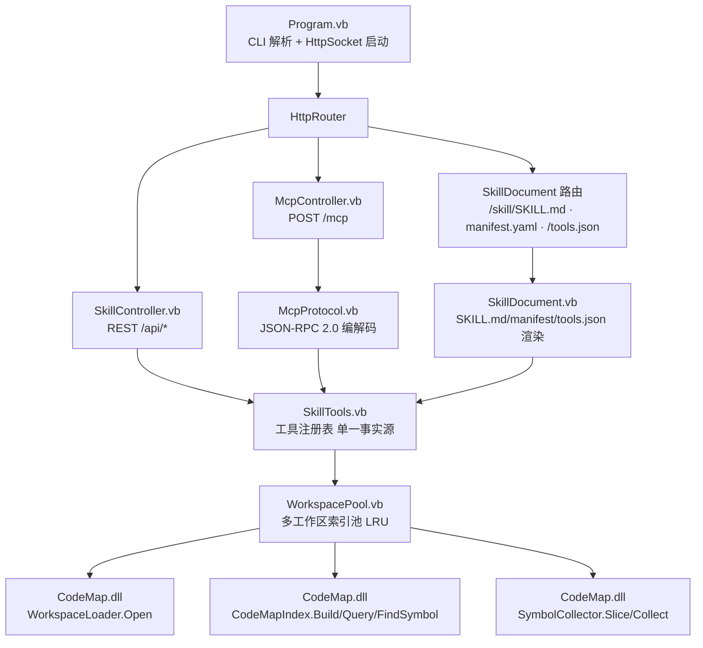

## 产品概述

把 `g:/DevAgent/src/CodeMap/CodeMap.vbproj` 中已有的 VB.NET 代码索引能力，封装为一个**标准 Agent Skill**，供 LLM agent 调用。CodeMap 当前是 dll（Library），需新建一个**控制台 VB.NET 项目**引用它，以 HTTP 服务形态对外提供能力：既提供 REST JSON 端点，也提供 MCP（JSON-RPC 2.0 over HTTP）端点；同时按标准 skill 规范产出 `SKILL.md` + `manifest.yaml`（服务托管一份、仓库落盘一份），使 agent 能像使用其它 skill 一样发现并调用它。

## 核心功能

- **服务形态**：控制台进程 `CodeMapSkill`，监听本地 HTTP 端口，启动即建索引，Ctrl+C 优雅关闭。
- **双协议能力暴露**：
- REST：`/api/status`、`/api/workspaces`、`/api/open`、`/api/workspace`、`/api/query`、`/api/symbol`、`/api/source`、`/api/members`、`/api/files`；
- MCP：`POST /mcp` 支持 `initialize`、`tools/list`、`tools/call`、`ping`，工具集覆盖上述全部能力（8 个工具）。
- **多工作区管理**：启动时可带默认 `--workspace`，运行期通过 `POST /api/open` 动态打开新仓库（同步返回 id、后台建索引），`GET /api/workspaces` 列表，按 id 切换；索引池带容量上限与 LRU 淘汰。
- **标准 skill 产物**：`SKILL.md`（YAML front-matter 含 name/description，正文含 `## Execution Flow`、`## Input Specification`、`## Output Specification`、`## Constraints` 四段标准标题）+ `manifest.yaml` + `scripts/` 调用脚本；由服务托管于 `/skill/SKILL.md`、`/skill/manifest.yaml`、`/tools.json`，并在仓库保留可直接拷进 skills 根目录的静态副本。
- **能力边界**：仅索引 VB.NET（`.sln` / `.slnx` / `.vbproj` / 源码文件夹），这一限制需明确写入 SKILL.md 的 Constraints。

## 技术栈选型

| 层次 | 选型 | 依据 |
| --- | --- | --- |
| 语言/框架 | VB.NET，`net10.0-windows`，`OutputType=Exe` | 必须与被引用方 `CodeMap.vbproj`（`net10.0-windows` + WinForms/WPF）兼容 |
| HTTP | Flute `HttpSocket` + `HttpRouter`（特性路由） | CodeMap 已在用，传递引用可得；`CodeMap/Program.vb` 与 `HttpService/CodeMapController.vb` 是可直接照抄的既有范式 |
| 索引内核 | CodeMap.dll：`WorkspaceLoader.Open`、`CodeMapIndex`、`SymbolCollector`、`IndexWorker` | 不重复实现，零改动复用 |
| JSON | sciBASIC# `Microsoft.VisualBasic.MIME.application.json`（`JsonObject`/`JsonArray`） | 与 Flute `WriteJSON` 底层的 `GetJson` 同一套，避免混用两套序列化 |
| Skill 规范 | `SKILL.md` + `manifest.yaml`（对齐 `g:/LLMs/src/Harness/SkillSystem` 的三层加载） | 用户既有 agent 的 skill 加载器 |


## 实现方案

**总体策略**：新增独立控制台工程，通过"工具注册表"把能力定义收敛成单一事实源，再由 REST 控制器与 MCP 端点共享；CodeMap 工程**一行不改**，仅把新工程登记进 `src/DevAgent.slnx`。

**关键技术决策**：

1. **单一事实源的工具注册表**（`SkillTools.vb`）。每个工具 = `{Name, Description, InputSchema(JsonObject), Invoke(args As JsonObject, ws As String) As Object}`。REST 端点与 MCP `tools/list`、`/tools.json` 全部由此表驱动，避免三处 schema 漂移；MCP `tools/call` 与 REST 走**同一个执行器**，保证行为一致。
2. **不复用 `CodeMap.HttpService.CodeMapController`**。它构造时绑死单个 `CodeMapIndex` 实例，无法支持多工作区与动态打开；新写 `SkillController` 覆盖并扩展其端点（`/api/query`、`/api/symbol`、`/api/status`、`/api/workspace` 的语义与返回形状保持兼容）。
3. **`IndexWorker.IndexInBackground` 直接复用**于工作区池：`POST /api/open` 同步校验路径并返回 id，随后后台线程 `WorkspaceLoader.Open` + `CodeMapIndex.Build`，未就绪期间查询返回 503（REST）/ JSON-RPC error（MCP），与 CodeMap 现有语义一致。
4. **MCP 采用无状态 Streamable HTTP**：`POST /mcp` 收单条 JSON-RPC，回 `application/json`；`notifications/*` 返回空 body + 200。不实现 SSE 流与 Session 复用（agent 侧主流客户端均支持无状态模式），显著降低复杂度。
5. **错误通道分离**：Flute 的 `WriteContent` 状态码固定 200、`WriteError` 只能输出 text/html 模板且无"任意状态码 + 任意 Content-Type"的高层方法——因此 REST 沿用 `WriteError(HTTP_RFC...)`，MCP 一律 HTTP 200 + JSON-RPC `error` 对象。
6. **安全**：`--host` 默认 `localhost` 只监听回环；`/api/source` 的路径必须解析后落在工作区 `RootPath` 内（防目录穿越）；`/api/open` 仅接受存在的路径。

**性能与可靠性**：

- 建索引 O(文件数 × 符号数)，后台单线程；`CodeMapIndex` 内部 `SyncLock` 原子换快照，查询线程安全。
- **坑位**：`SymbolCollector` 的 `cachePath/cacheLines` 是实例字段（单文件缓存），**非线程安全**；HttpSocket 多线程并发时必须**每请求 `New SymbolCollector`**，不可共享静态实例，否则会读到别的文件的行。
- 内存：索引池容量上限（默认 4，`--max-workspaces`）+ LRU 淘汰；`maxIndexChars`/`maxCodeLines`（默认 8000/200）限制单体符号体积；大仓库按 `--q 3` 的 q-gram 已是既有调优值。
- 日志：控制台输出，`--silent` 关闭 Flute 访问日志；`/api/open` 失败经 `MarkFailed` 落到 `/api/status`，不崩溃进程。

## 实现注意事项（防回归）

- 路由方法必须是 `Public` **实例** `Sub`，两个参数（`HttpRequest`/`HttpPOSTRequest`, `HttpResponse`）；同一路径的 GET 与 POST 要写成**两个方法**（Flute 发现逻辑是 If/ElseIf，一个方法标两个特性只有 GET 生效）。
- 读 MCP 原始 body：`IO.File.ReadAllText(req.POSTData.InputStream, req.POSTData.ContentEncoding)`——`PostData.InputStream` 是**临时文件路径字符串**，须在 handler 内同步读完。
- 返回已生成的 JSON/文本串用 `res.WriteContent(bytes, "application/json; charset=utf-8")`；**不要**把 JSON 字符串再交给 `WriteJSON`（会被二次转义）。对象才用 `WriteJSON`。
- `res.AccessControlAllowOrigin = "*"` 必须在写 header/body 前赋值。
- 新工程**不要**引入 `SkiaDriver.Register()`、WinForms 窗体或 treemap 相关调用（那是 CodeMap UI 路径，本服务无 UI）。
- 命名冲突：`Microsoft.VisualBasic.MIME...JsonRpc` 已存在，MCP 侧的 JSON-RPC 模型/模块请命名为 `McpJsonRpc` / `McpProtocol`，避免遮蔽。
- VB 陷阱：Module 成员不能 `Shared`；不要用裸 `Math.xxx`（可能被遮蔽）；局部变量不要与 `Path` 等类型同名。

## 架构设计



数据流：`POST /api/open` → 池创建 entry → 后台线程 `WorkspaceLoader.Open` → `CodeMapIndex.Build` → 状态置 ready；查询类端点 → 池按 `ws` 取 entry → 未 ready 返 503 → ready 则调索引 API → 序列化回 agent。

## 目录结构

```
g:/DevAgent/src/
├── DevAgent.slnx                              # [MODIFY] 登记新工程（仿照 CodeMap 节点，附 <Platform Solution="*|x64" Project="x64" />）
└── CodeMapSkill/                              # [NEW] 控制台工程根目录
    ├── CodeMapSkill.vbproj                    # [NEW] net10.0-windows / Exe / AssemblyName=CodeMapSkill / RootNamespace=CodeMapSkill / UseWindowsForms=true（稳定加载 CodeMap 类型）/ ProjectReference 指向 ..\CodeMap\CodeMap.vbproj
    ├── Program.vb                             # [NEW] Main：CLI(--port/--host/--workspace/--q/--top/--threshold/--max-lines/--max-workspaces/--silent/--help)、建池、注册三个控制器、HttpSocket 启动、CancelKeyPress 优雅 Shutdown、--help 打印端点与 MCP 用法
    ├── WorkspacePool.vb                       # [NEW] WorkspaceEntry{Id,Path,WorkspaceInfo,CodeMapIndex,LastAccess}；ConcurrentDictionary + LRU 淘汰 + 后台建索引任务；Get/List/Open/DefaultId/Status
    ├── SkillTools.vb                          # [NEW] ToolDescriptor{Name,Description,InputSchema,Invoke} + 8 个工具的注册与执行调度（status/list_workspaces/open_workspace/search_symbols/find_symbol/list_members/list_files/get_source）
    ├── Http/
    │   ├── SkillController.vb                 # [NEW] REST 路由：/ 、/api/status、/api/workspaces、/api/open(GET+POST)、/api/workspace、/api/query(GET+POST)、/api/symbol、/api/source、/api/members、/api/files
    │   ├── McpController.vb                   # [NEW] POST /mcp：读临时文件原始 body → McpProtocol 解析 → initialize/tools/list/tools/call/ping → WriteContent 写 JSON
    │   ├── SkillDocument.vb                   # [NEW] 渲染并托管 SKILL.md(text/markdown)、manifest.yaml(text/yaml)、/tools.json(application/json)，内容随端口与已打开工作区动态填充
    │   └── Models.vb                          # [NEW] REST 响应 DTO（QueryResponse/SymbolResponse/StatusResponse/WorkspaceSummary/SourceResponse/MembersResponse/FilesResponse），字段形状与 CodeMap 既有 DTO 保持一致
    ├── Mcp/
    │   └── McpProtocol.vb                     # [NEW] JSON-RPC 2.0 请求/响应/错误模型与编解码（命名避开既有 JsonRpc 类）、标准错误码、tools/list 与 tools/call 结果封装
    └── skill/vbnet-code-index/                # [NEW] 可直接拷进 skills 根目录的静态副本
        ├── SKILL.md                           # [NEW] front-matter(name/description/version/tags) + ## Execution Flow / ## Input Specification / ## Output Specification / ## Constraints + REST 与 MCP 用法附录
        ├── manifest.yaml                       # [NEW] name/version/description + always_load + references|scripts 的 on_demand 表
        └── scripts/                            # [NEW] PowerShell 调用脚本（query/symbol/source/mcp 各一），供 agent 直接执行
```

## 关键代码结构

```
' SkillTools.vb —— 单一事实源，同时驱动 REST、MCP tools/list、/tools.json
Public Class ToolDescriptor
    Public Property Name As String          ' 如 "search_symbols"
    Public Property Description As String
    Public Property InputSchema As JsonObject   ' JSON Schema (object/properties/required)
    Public Property Invoke As Func(Of JsonObject, String, ToolOutcome)  ' (args, workspaceId) -> outcome
End Class

Public Class ToolOutcome
    Public Property Ok As Boolean
    Public Property Payload As Object       ' 成功时可直接 WriteJSON / 作为 structuredContent
    Public Property ErrorMessage As String
    Public Property NotReady As Boolean     ' 索引未就绪 -> REST 503 / MCP error
End Class
```

```
' WorkspacePool.vb —— 多工作区索引池（线程安全，后台建索引）
Public Class WorkspacePool
    Public Function Open(path As String) As WorkspaceEntry   ' 同步返回，后台 Build
    Public Function TryGet(id As String, ByRef e As WorkspaceEntry) As Boolean
    Public Function List() As WorkspaceEntry()
    Public Property DefaultId As String
End Class
```

## Agent Extensions

### Skill

- **skill-creator**
- Purpose: 按标准 skill 规范编写 `src/CodeMapSkill/skill/vbnet-code-index/SKILL.md` 与 `manifest.yaml`，确保 front-matter 字段、四个标准二级标题与 on_demand 表结构能被 SkillSystem 的 Layer1/Layer2/Layer3 正确解析
- Expected outcome: 产出的 skill 目录可直接拷入 skills 根目录被 `SkillManager.ScanSkills` 扫描到，并能被 `SkillDefinition.BuildPromptFragment()` 正确抽取四个标准段落

### SubAgent

- **code-explorer**
- Purpose: 实现前核对 CodeMap 的 `WorkspaceInfo`/`SourceFile`/`LanguageSymbolType` 成员细节（用于 members/files/source 三个新端点）与 Flute 路由/响应 API 的精确签名
- Expected outcome: 拿到可直接落码的成员清单与签名证据，避免虚构 API 导致编译失败